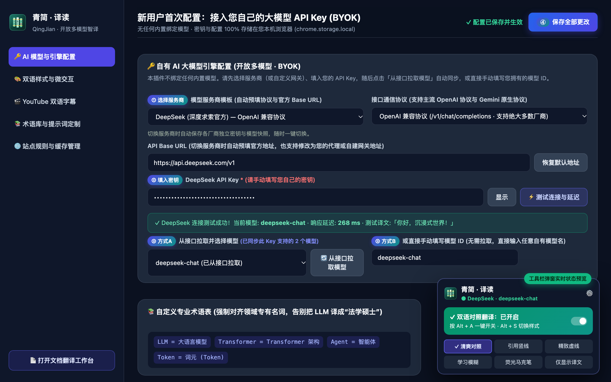
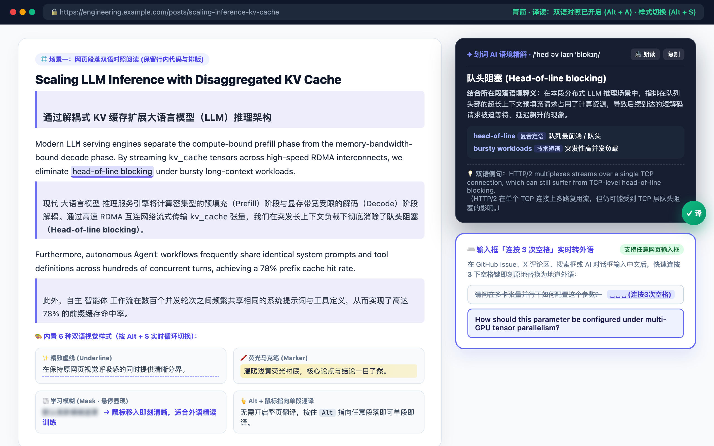
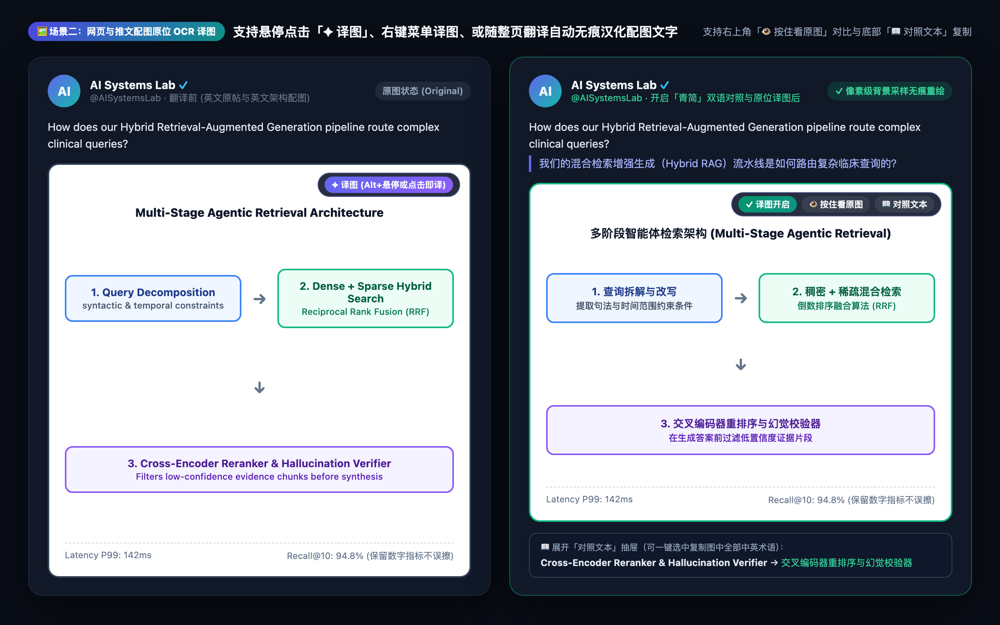
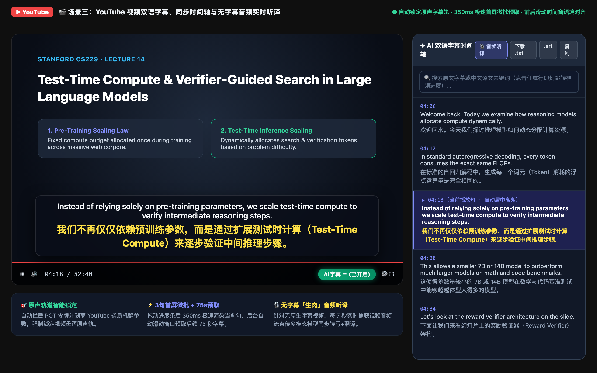
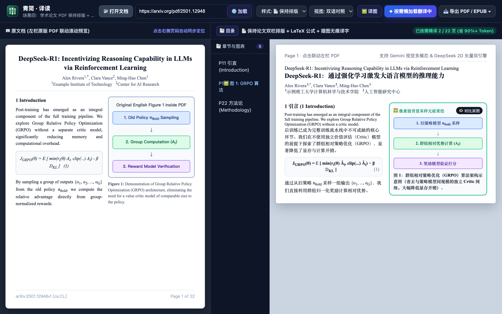
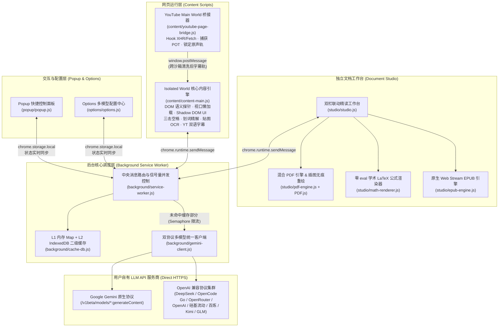

#  青简 · 译读 (QingJian) — 开放多模型双语精读与智译插件

[](./manifest.json)
[](./shared/constants.js)
[](./scripts/verify-extension.mjs)
[](./LICENSE)

> **竹简杀青，韦编成册；原文与译文并列案头，如展青简。**  
> 一款向「沉浸式翻译」致敬、面向自有大模型 API Key 用户的 **Manifest V3** 浏览器双语精读与多模态翻译扩展。**坚持「零内置模型绑定」的纯粹开放配置设计**——只要您拥有任意大模型平台的 API Key，即可一键接入网页双语对照、配图原位译文、YouTube 双语字幕与音频听译、以及保留原版面与插图的学术论文 PDF / EPUB / Markdown 文档翻译工作台。

---

## 📑 目录导航

- [0. 项目简介与「青简」命名释义](#0-项目简介与青简命名释义)
- [1. 致敬「沉浸式翻译」与项目初衷（纯粹开放 BYOK 理念）](#1-致敬沉浸式翻译与项目初衷纯粹开放-byok-理念)
- [2. 快速上手：新用户安装与首次模型配置全流程（含配置截图）](#2-快速上手新用户安装与首次模型配置全流程)
- [3. 四大核心场景使用案例与实机预览（含全场景截图）](#3-四大核心场景使用案例与实机预览)
  - [场景一：🌐 网页双语对照精读、划词语境精解与输入框「三击空格」写作](#场景一-网页双语对照精读划词语境精解与输入框三击空格写作)
  - [场景二：🖼️ 网页插图与 X (Twitter) 推文配图原位 OCR 无痕译图](#场景二️-网页插图与-x-twitter-推文配图原位-ocr-无痕译图)
  - [场景三：🎬 YouTube 视频双语字幕、同步时间轴与无字幕音频实时听译](#场景三-youtube-视频双语字幕同步时间轴与无字幕音频实时听译)
  - [场景四：📄 学术论文 PDF 保持排版精读、插图无痕重绘与 EPUB 电子书工作台](#场景四-学术论文-pdf-保持排版精读插图无痕重绘与-epub-电子书工作台)
- [4. 插件架构设计与底层技术实现详解](#4-插件架构设计与底层技术实现详解)
- [5. 开发者命令与自动化验证](#5-开发者命令与自动化验证)
- [6. 开源协议 (License)](#6-开源协议-license)

---

## 0. 项目简介与「青简」命名释义

### 0.1 什么是「青简 · 译读 (QingJian)」？

**青简 · 译读 (QingJian)** 是一款基于 Chrome Extension **Manifest V3** 规范构建的浏览器端、开放多模型（**BYOK — Bring Your Own Key**）双语精读与智能翻译扩展。

本插件**不预设或绑定任何内置模型**。用户只需填入自己持有的大模型 API Key（支持 **DeepSeek、Google Gemini、OpenCode Go、OpenRouter、OpenAI、SiliconFlow 硅基流动、阿里云百炼 Qwen、Moonshot Kimi、智谱 GLM** 以及任意兼容 OpenAI / Gemini 协议的自建网关），即可通过自动拉取模型列表或手动输入模型 ID，将自有大模型的长上下文理解、结构化输出与多模态能力深度融合进四大日常高频跨语言场景：

1. **🌐 网页双语对照与高频微交互**：不破坏原网页排版的段落级双语对照、网页/推文配图原位译文、划词语境精解、输入框「连按三次空格」实时转外语、`Alt + 鼠标悬停`单段速译；
2. **🎬 YouTube 双语字幕与多模态听译**：原声字幕轨道自动接管、滑动时间窗上下文合并翻译、右侧同步双语时间轴，以及针对无字幕「生肉」视频的多模态音频实时切片听译；
3. **📄 学术论文 PDF 保持排版精读工作台**：支持在线 PDF（如 `arxiv.org/pdf/...`）直连与本地上传，提供左栏原版 PDF 联动预览、右栏「保持论文单/双栏排版 + LaTeX 公式渲染 + **论文插图文字像素级擦除与原位无痕重绘**」，支持按需滚动懒加载（减少未阅读页面的初始请求）与导出保持排版 PDF；
4. **📗 EPUB / Markdown / HTML / SRT 全格式文档案头**：纯浏览器原生解析 EPUB 章节目录并一键打包导出真正的双语对照 `.bilingual.epub` 电子书。

### 0.2 关于「青简 (QingJian)」命名的解释说明

「**青简**」一词源于中国古代典籍治学传统，承载了本项目在文化意象、交互形态与工程哲学上的三重思考：

1. **文化溯源：杀青成简，信史流传**  
   古人截竹为简以著书立说，需先以火炙烤青竹使其渗出水分（史称「杀青」或「汗青」），如此方能历久弥新、字迹不泯；再用丝绳或韦皮将竹简编联成册（即「韦编」）。「青简」自古便是典籍、学问与案头研读的代名词。
2. **视觉与交互映射：三联青简，原文与译文并置印证**  
   本插件的图标（由 `scripts/generate-icons.mjs` 采用纯数学有符号距离场 SDF 与 4×4 超采样抗锯齿算法直接渲染生成）正是**「三联青简 · 韦编金扣 · 朱砂雅印」**的视觉凝练：
   - **左简为源**：代表外文原著、论文原典与视频原声；
   - **中简为枢**：代表居中调度、融会贯通的大语言模型智译引擎；
   - **右简落印**：代表经语境推敲后精准雅致的母语译文（右下角点缀一方朱砂雅印）。
   无论是在网页中「上原文、下译文」的呼吸感排布，还是在文档工作台中「左卷原典 PDF、右卷双语译文」的分栏对照，都恰似两列并置展读的青竹简牍，脉络分明、互为参证。
3. **工程哲学：大道至简，克制纯粹**  
   「简」既指竹简，亦代表**极简、零侵入、无负担**的工程追求：全项目采用 100% 原生 ES Modules 与现代 Web 标准 API 构建，无需打包器（Zero-Bundler）、无臃肿第三方 UI 框架、无任何后端中转服务器，做研读者与开发者浏览器中最温润趁手的一卷「数字青简」。

---

**v1.0.2 修复与使用边界**：见 [版本说明](./CHANGELOG.md)。本版修复译文错配、失败缓存、请求超时、跨文档/视频旧结果回写和 EPUB 结构问题。

- 配置密钥、拉取模型列表均不代表该模型的翻译、视觉或音频能力已经验证；请用自己的接口做一次实际翻译。
- OpenAI 兼容协议的 PDF 路径优先使用本地 PDF.js 提取文本与坐标，扫描件无法提取文字时会明确报错；当前不自动切换到 OpenAI 视觉 OCR。Gemini 路径按页使用多模态分析。
- 音频听译目前仅接入 Gemini 原生协议且要求模型支持音频，采用 7 秒切片请求，并非实时流式语音。
- PDF 重排与图片文字覆盖的效果取决于提取/识别质量，不保证像素级还原。EPUB 导出重建文本、章节和目录，不保留原书图片、字体、CSS 与复杂版式。
- 暂停或切换页面会丢弃旧响应；已经发送到服务商的请求可能继续执行并计费。使用量统计是本地估算，不能替代服务商账单。

## 1. 致敬「沉浸式翻译」与项目初衷（纯粹开放 BYOK 理念）

### 1.1 向标杆致敬

本项目的交互范式与产品设计深度致敬了浏览器扩展领域的标杆之作——**[沉浸式翻译 (Immersive Translate)](https://immersivetranslate.com/)**。

「沉浸式翻译」开创性地定义了现代浏览器跨语言阅读的黄金交互标准：
- **非破坏性的段落级双语对照**（克服了传统浏览器自带整页替换翻译导致看不清原文专有名词与代码结构的痛点）；
- **高频直觉化微交互**（输入框三击空格实时译、按住 `Alt` 鼠标悬停单段即译、多样化译文视觉样式如学习模糊遮罩等）；
- **全场景阅读延伸**（视频双语字幕、PDF 文献双栏对照、EPUB 双语电子书制作）。

本项目正是模仿与学习「沉浸式翻译」这一系列卓越产品设计与工程思想的致敬实践。

### 1.2 诞生契机：从“法学硕士”槽点到「零内置模型」的纯粹开放配置

#### 💡 一个真实又哭笑不得的痛点
作为「沉浸式翻译」免费版的长期重度用户，在日常阅读 AI 论文、技术博客和海外社区讨论时，免费传统机翻引擎（缺少大模型语境理解与领域知识）经常制造令人出戏的槽点——最典型的莫过于**每次看到文章里的 `LLM`（大语言模型），都会被生硬地翻译成「法学硕士」**，看多了实在让人抓狂（这也是为什么本插件内置默认术语表的第一行就是 `LLM = 大语言模型`）。

出于解决自身阅读痛点的诉求，并考虑到我自己（以及身边的许多开发者和科研朋友）手里本来就已经订阅或持有了多家大模型的 API 额度，**「青简 · 译读 (QingJian)」** 便由此诞生了。

#### 🔑 核心设计原则：无内置绑定模型，100% 释放用户自有 API 潜力
在实际科研、开发与日常阅读中，每位用户手中的 API Key 各不相同：
- 有的用户在 **DeepSeek**、**阿里云百炼**、**硅基流动 (SiliconFlow)**、**月之暗面 Kimi** 或 **智谱 GLM** 拥有高性价比的国产大模型密钥；
- 有的用户在 **Google AI Studio**、**OpenAI**、**OpenRouter** 或 **OpenCode Go** 拥有多模态与海外旗舰模型订阅；
- 还有的团队在内部部署了 **OneAPI / NewAPI / LiteLLM / Ollama / vLLM** 私有聚合网关。

因此，「青简 · 译读」确立了三条核心准则：
1. **零内置模型概念（No Hardcoded Models）**：插件不写死、不预绑任何所谓的“默认内置模型”。任何新用户安装后，第一步都是接入自己拥有的服务商 API Key 并拉取或填写自己的模型 ID。
2. **全功能无差别开放**：只要您配置的模型具备对应能力（例如纯文本模型即可驱动网页双语阅读、划词精解、YouTube 原生字幕翻译与基于 PDF.js 2D 矢量坐标重构的学术论文排版翻译；若接入支持 Vision/Audio 的多模态模型，还可额外解锁网页贴图 OCR、论文插图像素级擦除重绘与无字幕视频实时音频听译），所有高阶工作台功能均 100% 开放使用。
3. **浏览器直接请求（Zero-Server）**：所有 API Key、各厂商配置快照、专业术语表与翻译缓存均仅保存在本机浏览器（`chrome.storage.local` 与本地 `IndexedDB`），请求由浏览器直接发往您配置的 API Endpoint；项目不提供中转服务器，但您自行配置的网关可能属于第三方。翻译文本、图片、字幕、音频或文档页面会离开设备并交给该接口处理，API Key 随请求发送用于认证。

---

## 2. 快速上手：新用户安装与首次模型配置全流程

只要您手头拥有任意一家大模型平台的 API Key，只需 **2 分钟** 即可完成安装与配置。

### 2.1 第一步：安装插件到浏览器（支持 Chrome / Edge / Brave / Arc）

1. **获取代码**：克隆本仓库到本地，或在 [Releases](https://github.com/dqrcsc/qingjian-translator/releases) 页面下载最新打包好的 `.zip` 扩展包并解压：
   ```bash
   git clone https://github.com/dqrcsc/qingjian-translator.git
   ```
2. **打开扩展管理页**：在 Chrome 浏览器地址栏输入并访问 `chrome://extensions/`（Edge 浏览器访问 `edge://extensions/`）。
3. **开启开发者模式**：打开页面右上角的 **「开发者模式 (Developer mode)」** 开关。
4. **加载插件**：点击页面左上角的 **「加载已解压的扩展程序 (Load unpacked)」** 按钮，在文件选择器中选中克隆下来的仓库目录（或解压后的扩展文件夹）即可完成安装。
5. **固定到工具栏（推荐）**：点击浏览器右上角拼图图标 🧩，将 **「青简 · 译读」** 右侧的图钉 📌 点亮，方便随时一键呼出。

---

### 2.2 第二步：配置您自己的 API Key 与模型（4 步完成）

首次安装后，插件处于「待配置模型」状态。点击浏览器右上角 **「青简 · 译读」** 图标，在弹出面板中点击右上角 **`⚙️`**（或黄色提示条中的「前往设置」按钮），打开 **「设置与多模型引擎中心」**：



请按照上图中的 **① → ② → ③ → ④** 顺序完成首次配置：

1. **`① 选择服务商模板`**：
   - 在 **「模型服务商」** 下拉框中，选择您持有 API Key 的平台（内置 `DeepSeek`、`Google Gemini`、`OpenCode Go`、`OpenRouter`、`OpenAI`、`SiliconFlow 硅基流动`、`阿里云百炼 Qwen`、`Moonshot Kimi`、`智谱 GLM` 以及 `自定义服务商` 10 组预设模板）。
   - 切换服务商时，系统会**自动为您预填该厂商对应的「接口通信协议」与「官方默认 API Base URL」**（如果您使用的是第三方中转代理或自建网关，也可以随时手动修改 Base URL）。
2. **`② 填入您的 API Key`**：
   - 在 **「API Key」** 输入框中粘贴您的密钥。
   - 💡 *多厂商快照自动记忆*：您可以为 DeepSeek、Gemini、OpenRouter 等多个平台分别填入 Key，每次切换「模型服务商」下拉框时，系统会自动保存并恢复对应厂商的专属 Key 与模型配置，无需重复粘贴。
3. **`③ 选择或填写您的模型 ID（两种方式任选其一）`**：
   - **方式 A（一键从接口拉取）**：点击下拉框右侧的 **「🔄 从接口拉取模型」** 按钮，插件会直接向该服务商发起 `GET /models` 请求，自动过滤出您当前 API Key 支持的所有对话/多模态模型并填入左侧下拉框，直接点选即可；
   - **方式 B（手动直接填写）**：如果您已知晓自己要调用的模型名称（或者使用的是不支持 `/models` 列表接口的网关），直接在右侧 **「手动输入模型 ID」** 框内输入模型名称（例如 `deepseek-chat`、`gemini-2.5-flash`、`gpt-4.1-mini`、`qwen-plus` 等）即可。
4. **`④ 测试连通性并保存`**：
   - 点击 **「⚡ 测试连接与延迟」** 按钮，下方出现绿色的 `✓ 连接测试成功！当前模型: xxx · 响应延迟: xxx ms` 提示后，点击页面右上角的 **「保存全部更改」** 按钮。
   - 此时打开右上角扩展弹窗，状态指示灯将变为绿色 **「● 服务商 · 模型名」**，即可开始畅享全部功能！

---

### 2.3 主流服务商配置参数与能力速查表

为了方便您根据手头的 Key 快速填写，下表整理了各主流平台的默认协议、Base URL、常见模型 ID 示例以及支持的能力范围：

| 服务商名称 | 接口协议 | 默认 API Base URL | 常见模型 ID 填写示例（仅供手动输入参考） | 网页/字幕/划词/PDF排版 | 网页贴图OCR / 论文插图重绘 | 无字幕视频音频听译 |
| :--- | :--- | :--- | :--- | :---: | :---: | :---: |
| **Google Gemini** | Gemini 原生协议 | `https://generativelanguage.googleapis.com/v1beta` | `gemini-2.5-flash`、`gemini-2.5-pro` | ✅ 支持 | ✅ 原生多模态 | 支持音频输入的模型（7 秒切片） |
| **DeepSeek (深度求索)** | OpenAI 兼容协议 | `https://api.deepseek.com/v1` | `deepseek-chat`、`deepseek-reasoner` | ✅ 支持 (含 2D 矢量 PDF 重构) | ⚠️ 纯文本模型不支持看图 | — |
| **OpenRouter** | OpenAI 兼容协议 | `https://openrouter.ai/api/v1` | `google/gemini-2.5-flash`、`openai/gpt-4.1-mini` | ✅ 支持 | ✅ 选视觉模型支持 | — |
| **OpenAI (官方)** | OpenAI 兼容协议 | `https://api.openai.com/v1` | `gpt-4.1-mini`、`gpt-4o-mini`、`gpt-4o` | ✅ 支持 | ✅ 视觉模型支持 | — |
| **SiliconFlow (硅基流动)** | OpenAI 兼容协议 | `https://api.siliconflow.cn/v1` | `deepseek-ai/DeepSeek-V3`、`Qwen/Qwen2.5-VL-72B-Instruct` | ✅ 支持 | ✅ 选 VL 视觉模型支持 | — |
| **阿里云百炼 (Qwen)** | OpenAI 兼容协议 | `https://dashscope.aliyuncs.com/compatible-mode/v1` | `qwen-plus`、`qwen-turbo`、`qwen-vl-max` | ✅ 支持 | ✅ 选 VL 视觉模型支持 | — |
| **Moonshot (Kimi)** | OpenAI 兼容协议 | `https://api.moonshot.cn/v1` | `kimi-k2-0711-preview`、`moonshot-v1-8k-vision-preview` | ✅ 支持 | ✅ 选 Vision 模型支持 | — |
| **智谱 AI (BigModel)** | OpenAI 兼容协议 | `https://open.bigmodel.cn/api/paas/v4` | `glm-4-flash`、`glm-4-plus`、`glm-4v-plus` | ✅ 支持 | ✅ 选 4V 视觉模型支持 | — |
| **OpenCode Go** | OpenAI 兼容协议 | `https://opencode.ai/zen/go/v1` | `glm-5`、`kimi-k2.5`、`minimax-m2.5` | ✅ 支持 | 视具体模型而定 | — |
| **自定义网关 / Ollama** | OpenAI / Gemini 任选 | 填写您的 OneAPI / NewAPI / `http://localhost:11434/v1` 地址 | 填写您网关或本地部署的任意模型名称 | ✅ 支持 | 视具体模型而定 | 视具体模型而定 |

---

## 3. 四大核心场景使用案例与实机预览

下面通过 **4 个核心场景的实机界面截图与操作步骤**，带您快速了解如何在日常工作流中使用「青简 · 译读」。

---

### 场景一：🌐 网页双语对照精读、划词语境精解与输入框「三击空格」写作

> **适用人群**：日常阅读英文技术文档、GitHub Issues/PR、Hacker News、Reddit、海外新闻博客，或需要在网页输入框中快速用外语发帖、提问与回复的用户。



#### 📌 核心使用案例与操作方式：

1. **案例 1A：开启网页段落级双语对照（保留代码与公式排版）**
   - **如何触发**：打开任意外文网页，按下快捷键 **`Alt + A`**（或点击网页右侧悬浮的 **`译`** 字胶囊球，或点击浏览器右上角插件弹窗中的开关）。
   - **实际效果**：插件仅对进入屏幕可视区的段落按需发起翻译（滑到哪译到哪，极省 Token）。文中的行内代码（如 `LLM`、`kv_cache`、`Agent`）与数学公式会被自动占位保护，绝不会被误篡改；同时遵循您的自定义术语表，将 `LLM` 精准译为「大语言模型」。
   - **6 种双语样式秒切**：按下 **`Alt + S`** 可在页面上实时循环切换 6 种译文样式：`清爽对照`、`引用竖线`、`精致虚线`、`学习模糊（默认高斯模糊遮罩，鼠标移入即刻清晰，适合外语精读训练）`、`荧光马克笔` 与 `仅显示译文`。
2. **案例 1B：按住 `Alt` + 鼠标指向单段速译**
   - **如何触发**：当您不想开启整页翻译、只想看懂页面上某一段话时，直接将鼠标指向该段落并按住 **`Alt`** 键（macOS 为 **`Option`** 键），该段落即刻单独呈现双语译文；再次按 `Alt` 指向即可还原。
3. **案例 1C：划词 AI 语境精解（结合整段上下文释义）**
   - **如何触发**：用鼠标选中网页中的任意生词、技术黑话或长难句片段（如上图中的 `head-of-line blocking`），点击浮现的 **`✦`** 图标。
   - **实际效果**：不同于传统词典孤立地给出字面意思，插件会自动提取**选中词所在的整个自然段作为语境上下文**一并发送给大模型，在右上角深色毛玻璃卡片中返回：**结合当前段落语境的精准译文、IPA 音标、1~2 句语境深层解释、核心短语/语法拆解、双语例句**，并支持点击 `🔊 朗读` 调用原声发音。
4. **案例 1D：任意网页输入框「连按 3 次空格」实时转外语**
   - **如何触发**：在 GitHub 评论框、X (Twitter) 发帖框、Google 搜索框或任何网页的 `<input>` / `<textarea>` / 富文本编辑器中输入中文后，**在 450ms 内快速连续按下 3 次空格键（`Space × 3`）**。
   - **实际效果**：输入框内的中文会原地无缝替换为地道的目标外语（如英文），无需离开当前页面去复制粘贴翻译软件的结果。

---

### 场景二：🖼️ 网页插图与 X (Twitter) 推文配图原位 OCR 无痕译图

> **适用人群**：浏览 X (Twitter) 技术推文配图、技术博客中的系统架构图、信息图表（Infographics）或海外电商/产品功能对比图的用户。  
> *(注：此场景需将您的服务商模型配置为支持视觉识别的多模态模型，如 `gemini-2.5-flash`、`gpt-4o-mini`、`qwen-vl-max` 等)*



#### 📌 核心使用案例与操作方式：

1. **案例 2A：单张推文配图或架构图原位汉化**
   - **如何触发**：
     - **方式一（悬浮按钮）**：将鼠标移动到网页正文图片或 X 推文配图上，图片右上角会自动浮现 **`✦ 译图`** 按钮，点击即可；
     - **方式二（快捷键悬停）**：鼠标指向图片后按下 **`Alt`** 键；
     - **方式三（右键菜单）**：在图片上点击鼠标右键，选择 **「🖼️ 翻译此图片中的文字 (青简 · 译读)」**；
     - **方式四（随整页翻译自动触发）**：开启 `Alt + A` 整页双语翻译时，进入视口的信息图也会自动排队完成译图。
2. **案例 2B：原图/译图一键对比与图中术语复制**
   - **实际效果**：插件自动定位图片内每一处英文标签的 2D 坐标框并原位叠加自适应字号的中文译文，同时智能保留纯数字指标（如 `142ms`、`94.8%`）与箭头框线不被破坏。
   - **交互工具栏**：翻译完成后，图片右上角提供 **`✓ 译图开启`**、**`👁️ 按住看原图`**（随时核对原图英文）以及 **`📖 对照文本`**（点击后在图片下方展开双语文本抽屉，方便直接选中并复制图中的专业术语）。

---

### 场景三：🎬 YouTube 视频双语字幕、同步时间轴与无字幕音频实时听译

> **适用人群**：观看 YouTube 上的斯坦福/MIT 公开课、AI 开发者大会演讲、海外科技评测或无原生中文字幕的访谈视频的用户。



#### 📌 核心使用案例与操作方式：

1. **案例 3A：观看外语技术讲座自动加载上下文对齐的双语字幕**
   - **如何触发**：打开任意 YouTube 视频，插件会自动在播放器底部控制栏右侧注入绿色的 **`AI字幕 ☰`** 胶囊按钮，并自动拦截 YouTube 原生字幕请求、剥离劣质机翻参数，强制锁定视频的**原声母语轨道**。
   - **实际效果**：画面下方实时呈现「上原文、下译文」的高清毛玻璃双语字幕；拖拽视频进度条后，通过 **「3 句极速首屏微批 + 75 秒滑动窗口预取」** 机制，在模型返回后渲染当前播放句译文（实际延迟取决于网络、模型与缓存），并结合前后各 2 句上下文消除口语断句割裂感。
2. **案例 3B：使用右侧同步时间轴检索知识点、跳转进度与导出字幕**
   - **如何触发**：点击播放器控制栏上的 **`AI字幕 ☰`** 右侧图标（或在按钮上点击鼠标右键），即可在视频右侧展开 **「✦ AI 双语字幕时间轴」** 面板。
   - **实际效果**：
     - 随视频播放以 `60fps` 自动高亮并居中滚动当前字幕行；
     - 点击时间轴中的任意一行字幕，视频立即精准跳转至对应时间戳；
     - 顶部搜索框支持按英文原文或中文译文关键词实时过滤定位；
     - 点击顶部 **`下载 .txt`**、**`.srt`** 或 **`复制`**，即可一键导出带时间轴的双语字幕讲义。
3. **案例 3C：观看完全没有字幕的「生肉」视频（多模态音频实时听译）**
   - **如何触发**：当遇到既没有人工字幕、也没有 YouTube 自动生成字幕（ASR）的纯生肉外语视频时（需配置支持音频输入的 Gemini 模型），展开右侧时间轴并点击顶部的 **`🎙️ 音频听译`** 按钮。
   - **实际效果**：插件直接从 `<video>` 元素实时捕获音频流，每 **7 秒**切片直传多模态接口，同步完成「原声语音转写 + 中文翻译」，待模型返回后渲染到视频画面与右侧时间轴中。至少需要切片时长加接口响应时间；失败、停止或切换视频时会释放捕获资源，过慢时停止以避免请求积压。

---

### 场景四：📄 学术论文 PDF 保持排版精读、插图无痕重绘与 EPUB 电子书工作台

> **适用人群**：经常在 `arxiv.org`、`openreview.net` 阅读最新英文论文的科研人员与工程师，或需要阅读外文 EPUB 电子书、Markdown 技术文档的用户。



#### 📌 核心使用案例与操作方式：

1. **案例 4A：浏览在线 arXiv 论文时免下载一键直连精读**
   - **如何触发**：在浏览器中直接打开任意在线 PDF 链接（如 `https://arxiv.org/pdf/2501.12948`），浏览器右上角插件图标会自动亮起紫色的 **`PDF`** 徽标。此时直接按下快捷键 **`Alt + A`**（或点击右键菜单 **「📄 在新标签页双语翻译此在线 PDF」**），无需把 PDF 下载到电脑再手动上传，工作台会自动在新标签页打开并拉取该论文。
2. **案例 4B：按需滚动懒加载 + 保持学术论文双栏、公式与插图原位无痕重绘**
   - **如何触发**：进入工作台后点击右上角 **`✦ 开始翻译`**（或设置自动开始）。
   - **按需懒加载**：一篇 30 页的长论文，工作台默认仅立即精译**前 2 页**，当您向下滚动阅读到哪一页时才自动触发哪一页的翻译，避免为不看的附录与 References 浪费大量 Token。
   - **双引擎自适应（Gemini 视觉多模态 & DeepSeek/OpenAI 2D 矢量坐标重构）**：
     - 右栏 **「样式: 📄 保持排版」** 完整还原学术论文的居中标题、作者机构角标、单栏/双栏正文网格以及复杂的 **LaTeX 数学公式**（分式、积分、矩阵、希腊字母与公式编号）；
     - **论文插图文字无痕擦除与原位中文重绘**：自动裁剪出论文中的架构图/流程图，通过外围 72% 分位背景色采样与 PDF 矢量文字坐标聚类，将图内的英文标签无痕擦除并原位重绘为中文（点击图右上角 **`👁️ 对比原图`** 可随时切换查看英文原图）。
3. **案例 4C：剪贴板截图即粘即译 & 自定义页码范围导出保持排版 PDF / 双语 EPUB**
   - **截图即粘即译**：在工作台任意位置直接按 **`Ctrl + V`（macOS 按 `Cmd + V`）** 粘贴剪贴板中的论文截图或图表，立即弹出单图原位无痕翻译结果。
   - **灵活导出**：点击右上角 **`📥 导出`**，可选择导出 **保持排版双语 PDF** 或 **保持排版纯译文 PDF**（支持在弹窗中指定仅导出已译页，或自定义导出第 `1 ~ 12` 页正文以跳过参考文献）；若上传的是 `.epub` 电子书，还可直接打包导出标准 **`.bilingual.epub`** 双语电子书，直接导入 Apple Books、Kindle 或 Calibre 阅读。

---

### 3.5 常用快捷键与微交互速查表

| 交互操作 / 快捷键 | 功能说明 |
| :--- | :--- |
| **`Alt + A`** | 一键开启/关闭当前网页双语对照翻译；若当前正在浏览在线 PDF 链接，则直接在新标签页打开文档翻译工作台并开始精译 |
| **`Alt + S`** | 在网页中循环切换 6 种双语译文显示样式（清爽对照 / 引用竖线 / 精致虚线 / 学习模糊 / 荧光马克笔 / 仅看译文） |
| **`按住 Alt + 鼠标指向段落/图片`** | 无需开启整页翻译，单独翻译或还原鼠标当前悬停的段落或图片 |
| **`输入框内快速连按 3 次空格`** | 将当前输入框（`<input>` / `<textarea>` / 富文本编辑器）内的文字实时翻译并替换为目标外语 |
| **`选中文本 → 点击 ✦ 按钮`** | 结合选中词所在的完整段落上下文，弹出 AI 语境精解、音标、核心词汇/语法拆解与双语例句（支持原声朗读） |
| **`工作台内按 Ctrl+V / Cmd+V`** | 在文档翻译工作台中直接粘贴剪贴板中的论文插图或截图，立即触发 OCR 识别与原位无痕译图 |

---

## 4. 插件架构设计与底层技术实现详解

### 4.1 整体架构拓扑（Manifest V3 五层协同架构）

插件严格遵循 Chrome Extension Manifest V3 安全规范，将职责解耦为五个独立运行的上下文层，通过消息总线与跨沙箱桥接协同工作：



### 4.2 代码目录结构

```text
translator_plugin/
├── manifest.json                 # Manifest V3 声明文件（权限、快捷键、Main/Isolated 双世界注入配置）
├── package.json                  # 开发者脚本入口（图标生成、自动化校验套件与发布打包）
├── docs/screenshots/             # 核心配置与四大使用场景高清实机预览图
├── shared/                       # 跨上下文共享模块
│   ├── constants.js              # 10 大服务商连接模板（零内置模型绑定）、6 种译文样式、语调预设与消息枚举
│   ├── storage.js                # 基于 chrome.storage.local 的配置持久化、多厂商独立快照切换与术语表解析器
│   └── utils.js                  # 64-bit FNV-1a 哈希、SRT/VTT 字幕解析器、动态分批算法、在线 PDF 链接规范化
├── background/                   # 后台 Service Worker 调度核心（ES Module）
│   ├── service-worker.js         # 消息分发总线、Promise 信号量并发控制、右键菜单、快捷键与在线 PDF 徽标监听
│   ├── gemini-client.js          # Gemini 原生协议与 OpenAI 兼容协议双引擎客户端、动态模型发现与多模态负载组装
│   └── cache-db.js               # L1 In-Memory Map (LRU) + L2 IndexedDB 双层持久化翻译缓存
├── content/                      # 网页注入脚本与样式
│   ├── content-main.js           # 网页 DOM 探针、占位保护、懒加载队列、Shadow DOM 悬浮球/划词弹窗、贴图译文、YT 字幕渲染
│   ├── content.css               # 6 种双语对照视觉样式、响应式行内/块级排版、YouTube 字幕叠加层与时间轴样式
│   └── youtube-page-bridge.js    # 运行于 world: "MAIN" (document_start)，拦截 timedtext、捕获 POT 令牌、提取原声字幕
├── studio/                       # 独立文档翻译工作台 (PDF / EPUB / Markdown / HTML / SRT)
│   ├── studio.html / studio.css  # 双栏同步视图、章节/图表大纲侧边栏、保持排版 PDF 导出确认与进度弹窗
│   ├── studio.js                 # 工作台主控制器：在线 PDF 拉取、按需滚动懒加载翻译、双栏平滑联动、多格式导出
│   ├── pdf-engine.js             # PDF.js 页面 Canvas 渲染、矢量文本坐标聚类、像素级背景采样擦除与原位中文重绘、本地 FlateDecode 解压
│   ├── math-renderer.js          # 零 eval 纯原生学术 LaTeX 数学公式解析渲染器（支持分式/矩阵/积分/希腊字母/作者机构上标）
│   ├── epub-engine.js            # 基于原生 DecompressionStream 的零依赖 ZIP/EPUB 解析器与 CRC32 双语 EPUB 3 打包器
│   └── vendor/                   # 本地内置 PDF.js 渲染与矢量文本解析核心 (pdf.js / pdf_worker.js)
├── popup/                        # 浏览器工具栏弹出控制面板 (popup.html / popup.css / popup.js)
├── options/                      # 全功能设置中心与多模型测试台 (options.html / options.css / options.js)
├── icons/                        # 插件标准尺寸图标 (icon-16.png, icon-48.png, icon-128.png)
├── scripts/                      # 零依赖工程工具链
│   ├── generate-icons.mjs        # 基于纯 Node.js zlib 与 SDF 距离场算法生成「三联青简」图标
│   ├── verify-extension.mjs      # 自动化校验套件（MV3 规范、JS 语法检查、CSP 合规审计、核心引擎单元测试）
│   └── pack-release.mjs          # 零依赖发布打包脚本（自动生成纯净 Chrome 扩展 .zip 归档包）
├── CHROMEWEBSTORE.md             # Chrome Web Store 商店元数据、权限理由与隐私合规说明
└── LICENSE                       # MIT 开源许可协议
```

### 4.3 核心工程机制与技术亮点

#### 1) 纯粹开放的双协议多模型统一路由层 (`background/gemini-client.js` & `shared/storage.js`)
- **多厂商独立配置快照 (`providerConfigs`)**：内置 **Google Gemini、DeepSeek、OpenCode Go、OpenRouter、OpenAI、SiliconFlow、阿里云百炼、Moonshot Kimi、智谱 GLM、自定义网关** 10 组连接模板（仅预填通信协议与官方 Base URL，不预绑任何写死模型）。用户在设置页切换厂商时，系统自动保存并恢复各厂商专属的 `apiKey`、`apiBaseUrl`、`apiProtocol`、`modelId` 与已拉取的 `availableModels`。
- **动态模型列表发现 (`fetchAvailableModels`) 与手动直填双轨制**：支持一键调用上游 `GET /models` 接口，自动过滤掉 Embedding / TTS / Rerank / 文生图等非对话模型，将当前 API Key 可用的真实模型列表同步至本地下拉框；同时也支持用户直接手动输入任意自有或微调模型 ID。
- **Google Gemini 原生协议优化**：
  - 使用 `responseMimeType: "application/json"` 配合严格的 `responseSchema`，从协议层保证批量段落翻译返回的 `{ id, translation }` 数组结构 100% 合法；
  - **Flash 模型零思考延迟优化 (`buildFastGenerationConfig`)**：针对 Gemini Flash 系列实时翻译场景，自动注入 `thinkingConfig: { thinkingBudget: 0 }`（并在不支持该参数的模型上自动优雅降级重试），大幅降低首字延迟（TTFT）。
- **OpenAI 兼容协议自适应**：
  - 智能推断 Base URL 结构（无论用户输入 `https://api.xxx.com`、`https://api.xxx.com/v1` 还是完整 `/v1/chat/completions`），并在 404 时自动尝试备选路径；
  - 自动清理推理模型（如 `deepseek-reasoner` / R1 系列）输出中的 `<think>...</think>` 思考过程块，提取纯净 JSON 或译文；
  - 将多模态图像请求自动转换为标准 OpenAI Vision `image_url` (`data:image/jpeg;base64,...`) 消息格式。

#### 2) 二级翻译缓存与增量命中机制 (`background/cache-db.js`)
- **确定性缓存签名 (`buildCacheKey`)**：使用 64 位 FNV-1a 变体哈希算法（`shared/utils.js` 中的 `hashString`），对 `目标语言 | 模型ID | 术语表哈希签名 | 归一化源文本` 计算紧凑的 16 进制摘要。当用户修改了自定义术语表或切换了目标语言/模型时，旧缓存不会产生脏读。
- **L1 内存 Map + L2 IndexedDB 持久化**：
  - **L1 (`memCache`)**：常驻 Service Worker 内存，容量上限 2,500 条（FIFO/LRU 淘汰），提供微秒级同步读取；
  - **L2 (`ImmersiveGeminiCacheDB`)**：浏览器本地 IndexedDB 对象仓库，跨会话持久化保存历史译文。
- **Batch 粒度部分命中过滤**：在 `handleTranslateBatch` 中，如果一个批次的 10 个段落中有 7 个已在缓存中命中，插件会直接取出这 7 个缓存结果，**仅将剩余 3 个未命中段落打包发送给大模型**，最大化节省用户 Token。

#### 3) 信号量并发控制与动态双阈值分批 (`service-worker.js` & `utils.js`)
- **轻量级异步信号量 (`withConcurrencyLimit`)**：在 Service Worker 中维护 `activeRequests` 与 `waitQueue` 队列，限制同时在途的 LLM 请求数（默认 `maxConcurrency = 3`，可在 1~8 之间配置），避免高密度滚动网页时瞬间发出数十个请求触发上游 API 的 `429 Too Many Requests` 限流。
- **双阈值智能打包 (`createBatches`)**：同时受 `batchMaxItems`（默认 10 段）与 `batchMaxChars`（默认 2,200 字符）约束，既防止单次请求 Token 过长导致输出截断，又避免短词条单独成批造成请求往返浪费。

#### 4) 网页 DOM 语义探针、YouTube 跨沙箱拦截与 PDF 像素级插图重绘
- **网页 DOM 语义探针 (`content/content-main.js`)**：自顶向下识别散文块与 UI 叶子节点，自动剔除 `.sr-only`、`aria-hidden="true"` 与图标字体节点，对行内 `<code>` 与数学公式执行 `{{n}}` 占位保护，并根据容器 Flex/Grid 布局自动切换 Block（段落上下对照）与 Inline（同行紧随对照）注入模式。
- **YouTube 双沙箱字幕引擎 (`content/youtube-page-bridge.js`)**：在 `world: "MAIN"` 拦截 `/api/timedtext` 请求并捕获 `pot` 会话令牌，自动剥离 `tlang` 机翻参数锁定原声轨道，合并 ASR 碎句，并通过 `window.postMessage` 将清洗后的字幕流移交 Isolated World 执行两级预取与滑动上下文窗口翻译。
- **PDF 论文双引擎重构与插图像素级无痕汉化 (`studio/pdf-engine.js` & `studio/math-renderer.js`)**：
  - 结合内置 `PDF.js` 的 2.0x 高清 Canvas 渲染与 `page.getTextContent()` 矢量文本坐标矩阵，既支持 Gemini 多模态端到端视觉版面理解，也支持 DeepSeek 等纯文本模型的 2D 坐标双栏/标题/公式/图注精确重构；
  - 对论文插图采用**「外围 2px 周长 72% 分位亮度背景色采样 + 内部高对比度墨水字色提取 + 行级紧致擦除 (水平 ±1px) + 原位中文折行重绘」**管线，在保留流程图框线与箭头完整性的前提下实现原生级图表汉化；
  - 内置零 `eval` 的纯原生递归下降 LaTeX 数学公式渲染器与原生 `DecompressionStream` EPUB 3 解析打包器，100% 符合 Manifest V3 严格 CSP 规范。

---

## 5. 开发者命令与自动化验证

本项目提供零外部依赖的图标生成、自动化回归测试与发布打包工具链（要求 Node.js 18+）：

```bash
# 1. 使用纯 Node.js SDF 渲染引擎重新生成 16x16 / 48x48 / 128x128 「三联青简」图标
npm run icons

# 2. 运行 43 项原有检查与 22 项故障回归（模拟接口，不等于实机或安全审计）
npm run verify

# 3. 先验证，再打包并检查实际 ZIP 内容与许可证 (输出至 dist/qingjian-translator-v1.0.2.zip)
npm run pack

# 4. 一键执行全流程构建（生成图标 + 自动化校验 + 打包 ZIP）
npm run build
```

---

## 6. 开源协议 (License)

本项目自身代码基于 [MIT License](./LICENSE) 开源；内置 PDF.js 使用 Apache-2.0，详见 [第三方软件说明](./THIRD_PARTY_NOTICES.md)。欢迎自由使用、Fork 与提交 Pull Request。
